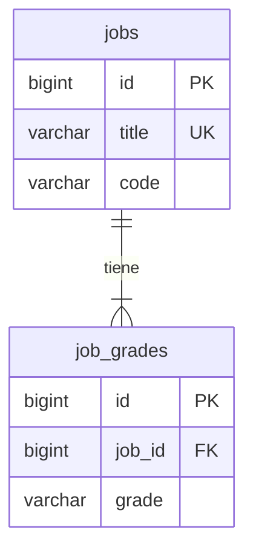

# Cargos y aprobaciones masivas

Talento Humano dispone de **Administración → Cargos y grados**. Registre el nombre, el código y el primer grado. Para un mismo cargo, use «Agregar un grado»; no cree el cargo de nuevo para cambiar su grado. Los códigos y grados se guardan como texto y conservan los ceros iniciales.

En **Funcionarios**, seleccione el cargo y después uno de sus grados. El código se carga automáticamente. El servidor valida la combinación también al crear, editar e importar por Excel: registre antes los cargos y grados del archivo. Un error revierte toda la importación e identifica la fila.

«Editar cargo» actualiza el nombre o código del catálogo y los datos actuales de los funcionarios asociados. Las solicitudes radicadas conservan su copia histórica. Los registros anteriores sin código o grado se trasladan sin inventar valores; Talento Humano debe completar el catálogo antes de usarlos en nuevas asignaciones.

## Aprobación masiva

La aprobación individual y la masiva ejecutan las mismas comprobaciones dentro de una transacción por solicitud: responsable y rol vigentes, etapa pendiente, fecha de inicio futura, soporte obligatorio, duración configurada, cupo ordinario y vigencia/reserva de actos administrativos cuando corresponda.

Si una solicitud falla, su transacción se revierte y el lote continúa. La bandeja muestra el resumen y el motivo **No aprobada** en la fila correspondiente. El mensaje permanece al recargar la bandeja y se actualiza al realizar el siguiente lote. Las solicitudes aprobadas conservan su historial, observación, aprobador y fecha y hora.

## Actualización de una instalación existente

Ejecute con PHP el script `scripts/update-job-catalog.php`. Crea primero un respaldo privado verificado y agrega las tablas `jobs` y `job_grades`. El traslado inicial reúne los cargos y grados ya registrados en los funcionarios. Si un mismo cargo tiene códigos contradictorios, detiene el traslado para que se corrijan; no elige un código automáticamente.

El script admite `--config` con un archivo PHP privado dentro de `.work` para conectarse a otra base usando las credenciales de administración. No se ejecutan migraciones desde el navegador ni se amplían los privilegios del usuario web.

La combinación `job_id, grade` es única. `users.job_title`, `users.code` y `users.grade` contienen los valores elegidos y se validan contra el catálogo. `requests.snapshot` conserva los valores históricos al radicar.
