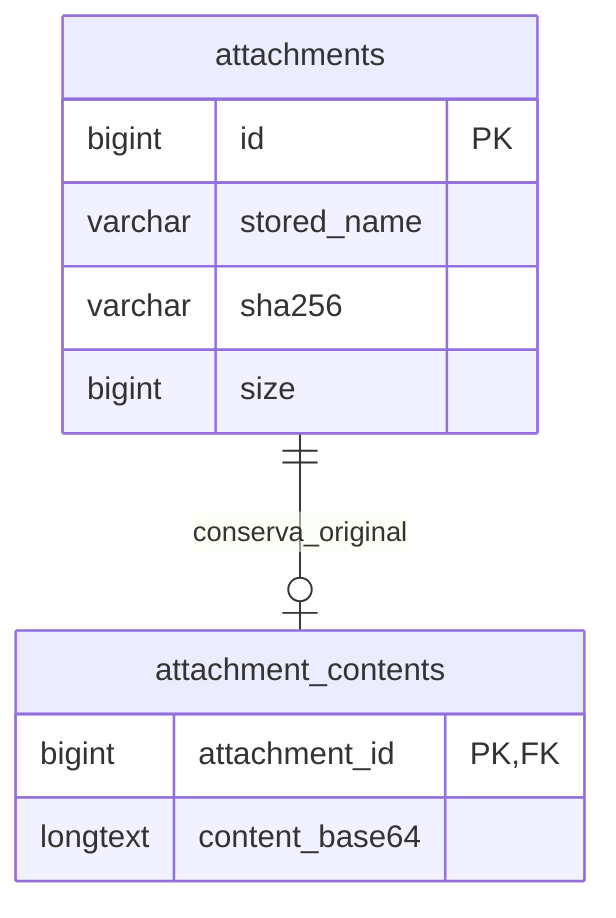

# Publicación de la demostración en Internet

La aplicación conserva MySQL 8.4 o superior tanto localmente como en Internet. No se sustituye por MariaDB.

El contenedor de `Dockerfile` ejecuta PHP 8.4 y Apache con raíz pública en `public/`. Las carpetas `app`, `config`, `database`, `views`, `vendor` y `storage` quedan fuera de la raíz web. La imagen se construye con una lista explícita de archivos; excluye la configuración local, las contraseñas, las bases locales, los respaldos y todos los soportes del cliente.

Para Render se utiliza un Web Service de tipo Docker con instancia **Free** y puerto 10000. La base es un servicio **MySQL Free** de Aiven, separado del contenedor. Ambas cuentas deben permanecer sin método de pago ni recursos de pago si se quiere mantener esta demostración gratuita.

Variables privadas del servicio web:

| Variable | Contenido |
| --- | --- |
| `APP_CLOUD` | `1` |
| `APP_BASE_URL` | URL HTTPS de la aplicación |
| `APP_MYSQL_HOST` | Servidor de Aiven |
| `APP_MYSQL_PORT` | Puerto asignado |
| `APP_MYSQL_DATABASE` | Base MySQL de la aplicación |
| `APP_MYSQL_USERNAME` | Usuario con acceso a esa base |
| `APP_MYSQL_PASSWORD` | Contraseña de ese usuario |
| `APP_MYSQL_CA_BASE64` | Certificado CA de Aiven codificado en base64 |

La conexión MySQL usa TLS y verifica el certificado del servidor. No se deben poner estas variables en GitHub ni en los registros públicos del despliegue.

La inicialización se realiza una sola vez desde el equipo de administración con `php scripts/initialize-cloud.php --config=.work/cloud-target.php --confirm=INITIALIZE_EMPTY_MYSQL`. El archivo privado contiene la conexión administrativa y la CA. El comando rechaza bases con tablas, instala el esquema y los seis usuarios originales y crea `permisos_app` con acceso solo SELECT, INSERT, UPDATE y DELETE a esa base y obligación de usar TLS. Guarda las claves de demostración y la conexión web en archivos privados de `storage/cloud-FECHA-*`; no muestra contraseñas en consola. No se ejecuta durante el arranque ni al redesplegar.

En modo nube, los soportes originales se guardan en `attachment_contents`, relacionados con `attachments`. El archivo local que se usa para descargar o incorporar un soporte al PDF es una caché que puede reconstruirse desde MySQL, verificando su tamaño y SHA-256. Reiniciar o redesplegar el contenedor no elimina los originales. En modo local se conserva el almacenamiento de soportes en disco.

El plan gratuito de Render se suspende tras 15 minutos sin tráfico y tarda aproximadamente un minuto en reactivarse. Las sesiones se reinician al reemplazar el contenedor; los trámites y soportes permanecen en MySQL. Aiven Free incluye 1 GB de disco, compartido entre datos y soportes; la codificación base64 aumenta el tamaño de los soportes aproximadamente un tercio.

Los avisos de correo siguen usando la cola existente. Para enviarlos se debe configurar un proveedor compatible con las restricciones de red del alojamiento; el envío no se activa por registrar estas cuentas.

Para restaurar la demostración local: `php scripts/restore-original-demo.php --confirm=RESTORE_ORIGINAL_DEMO`. La operación genera un respaldo privado antes de eliminar datos, conserva seis usuarios ficticios, tres dependencias y el catálogo de 17 tipos, genera claves nuevas e invalida las sesiones anteriores. Los accesos quedan en `storage/acceso-demo-restaurado.txt`.
